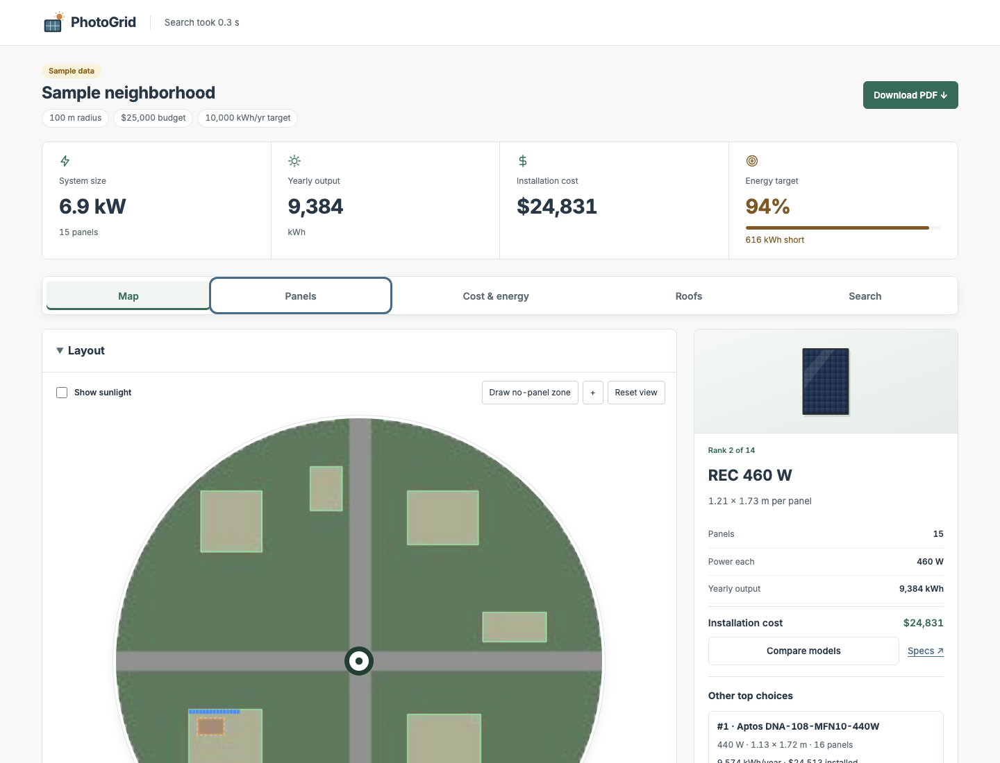

# PhotoGrid

**See what solar fits on every roof in a neighborhood, within your budget, in under a minute.**

Enter a U.S. address, a search radius, a budget and how much electricity you need. PhotoGrid pulls Google's aerial imagery and sunlight data for the whole circle, finds every roof, flags panels that are already installed, and lays out real, purchasable solar panels on the sunniest open roof space. It compares 14 rooftop panel models from a sourced catalog, shows the installation cost, bill savings, payback and CO₂ avoided, and exports a PDF report. Run it locally or deploy the shared hackathon demo. Your local Google key stays in the ignored `.env` file and is never included in Git, saved searches or reports.



[Deploy PhotoGrid on Render](https://render.com/deploy?repo=https://github.com/rishancoding/PHS-Hackathon-LHS) · [Public website setup](docs/DEPLOYMENT.md)

The public website is not deployed yet. The included `render.yaml` names the
service `photogrid`; Render assigns its final URL after you connect your account.
The shared hosted demo starts without a Google key and supports the sample area.

## Quick start

```sh
python3 -m venv .venv
.venv/bin/python -m pip install -r requirements.txt
cp .env.example .env            # then put your key in .env: GOOGLE_MAPS_API_KEY=...
.venv/bin/python roofready_app.py
```

Open **http://127.0.0.1:5001/photogrid** (the original `/` address also works). Click **Try the sample area** to explore with clearly labeled synthetic data and no Google requests, or enter an address and click **Find roofs and panels**.

Requirements: Python 3.10 or newer, and a Google Cloud key with the **Geocoding**, **Solar** and **Places (New)** APIs enabled. Google Maps Platform is billed per request; restrict the key to those three APIs and set a daily quota and budget alert in Google Cloud. To use another port: `.venv/bin/python roofready_app.py --port 5002`. Stop the server with Control+C.

## What it does

After a search, results are split into tabs under an address header (street, city and state only) and four summary tiles (system size, yearly output, installation cost, energy target).

- **Map:** the search circle in a circular frame. Green outlines are roofs, blue rectangles are proposed panels, orange areas are possible existing panels, red boxes are no-panel zones. Scroll, pinch or + to zoom; drag to pan; **Reset view** returns to the full circle. **Show sunlight** overlays Google's yearly sunlight. **Draw no-panel zone** lets you drag boxes over vents, skylights, rooftop equipment or setbacks (or use **Zone over selected roof** from the keyboard); **Apply & re-plan** rearranges or reduces panels instantly, with no new downloads. The side panel shows the plotted panel and its key numbers. **Compare models** opens two alternatives from the top three beside the map; **Preview on map** changes the layout without leaving the Map tab. **See more options** opens the full Panels tab. To remove no-panel zones, use **Remove** or **Remove all zones**, then **Apply & re-plan**. The apply controls remain available even after the final zone is removed, and applying zone changes preserves the selected panel model.
- **Panels:** every comparable model as a card, best first, four visible at a time with the rest scrolling inside the box. Each card has a to-scale drawing made from the catalog data (not a product photo), yearly output, installation cost, panel count, hardware cost per watt, a target-coverage bar, up to two highlight chips (such as "Most output" or "Fewest panels") and the documented warranty. **Preview** plots that model on the map. **Compare two models** shows six performance measures side by side and marks the better value in each row.
- **Cost & energy:** cost breakdown against your budget, energy figures, and an **Impact** card with estimated yearly bill savings, simple payback, CO₂ avoided and homes' worth of electricity. **Methods & assumptions** lists every source and the search findings.
- **Roofs:** **Look up roof addresses** names each roof by its street address (one Google request per roof); roofs are listed after the lookup. Uncheck roofs to leave them out of the plan. CSV and GeoJSON downloads.
- **Search:** the search form, and **Update plan with these settings** to change budget, target, panel-area cap, priority or system efficiency without new Google requests.

Other features: address suggestions as you type, recent searches as suggestions, saved searches that reopen after a restart (newest first, one per address and radius, with date), a loading screen with real progress stages, the search time in the header, and a multi-page **Download PDF** report.

## How it works

1. **Locate:** Google Geocoding resolves the address and checks it is in the lower 48 states or DC.
2. **Download:** the Google Solar API returns four layers for the circle: aerial imagery, a rooftop mask, yearly sunlight (kWh/kW/year) and elevation. If Google has no high-quality imagery for the area, PhotoGrid retries once with medium quality and says so under the map. A repeat search of the same center and radius reuses the saved layers, so it takes about 3 seconds instead of about 40.
3. **Find roofs:** the layers are aligned on a local meter grid and clipped to the circle; connected regions of Google's rooftop mask become candidate roofs (10 m² minimum), ranked by theoretical potential.
4. **Flag existing panels:** a color-and-texture check marks slate-blue, panel-shaped areas on roofs so new panels avoid them.
5. **Place panels:** for each of the 14 rooftop models, the planner fills the sunniest roofs first. On each roof it aligns a grid with the building, tries both module orientations with 0.2 m gaps, keeps panels fully inside the outline and away from flagged and blocked areas, and fills the sunniest spots first using the per-pixel sunlight. It stops at your energy target, budget, panel-area cap or the available space.
6. **Rank:** plans that meet the target within budget come first, then partial plans (smallest shortfall first), then models that do not fit. Within a tier your priority decides: lowest cost, least roof space or longest warranty.
7. **Estimate:** cost, energy, savings, payback and emissions for the chosen plan; everything is saved under `outputs/` and can be exported.

Timing: a first live search takes about 40 seconds, about 93% of it downloading Google's imagery. Roof processing takes 2–3 seconds and comparing all 14 models under a second.

## Accuracy, assumptions and limits

- **Energy:** panel watts × Google's per-spot yearly sunlight × **system efficiency 0.85** (inverter, wiring and soiling losses; adjustable under Assumptions). Roof figures labeled "theoretical potential" use a generic 0.20 kW/m² over 65% of each roof and are separate from your layout.
- **Cost:** NREL's Q1 2024 U.S. residential benchmark of $3.15/W (2023 dollars) with illustrative regional multipliers (Northeast 1.12, Midwest 0.95, South 0.95, West 1.08). Each model's installed cost is its catalog price plus watts × (regional benchmark − a $0.35/W reference module allowance, which is a modeling assumption). The likely range is ±25%. Screening estimates before incentives, excluding batteries, shipping and tax; not quotes. [NREL report](https://www.nrel.gov/docs/fy25osti/92257.pdf)
- **Savings and payback:** each kWh produced offsets one kWh at the state's 2025 average residential price (EIA, preliminary). No incentives: the federal 25D residential credit ended for systems placed in service after 2025. Net-metering rules, rate changes and degradation are not modeled.
- **CO₂ and homes:** EPA eGRID2023 U.S. non-baseload rate (1,372 lb CO₂/MWh), the generation solar mostly displaces; average U.S. home about 10,400 kWh/year (EIA).
- **Panels:** `data/panel_catalog.csv` holds 24 models with datasheet and retailer links. Four residential modules (Qcells 425 W, REC 460 W, Aptos 440 W, Silfab 430 W) were priced on 2026-10-11; the rest are smaller off-grid panels. Portable/flexible models and modules under 100 W are not compared as rooftop hardware. Stock is ignored.
- **Existing-panel detection** is a color check, not a trained model. On 48 roofs from 7 sites (Mountain View, Fremont, Burbank, San Jose and Lancaster, CA; Golden, CO; Phoenix, AZ), hand-labeled by eye, it classified 73% of roofs correctly (68% precision, 65% recall). It misses dark navy and some house panels, and flags things in blue-tinted imagery (all false flags were in Phoenix). Verify against the imagery.
- **Not detected:** rooftop equipment, slope (areas are horizontal footprint, which is conservative on pitched roofs), fire setbacks, structural condition and ownership. Sunlight-aware placement can choose sunny equipment tops; draw no-panel zones over them. Touching roofs may merge into one region. Results are a screening layout, not an installation design.
- **Addresses** come from Google reverse geocoding at a point inside each roof; matches outside the roof are marked approximate and do not prove ownership.

## Data, privacy and saved searches

The local server accepts only localhost and rejects POST requests from other sites. The optional Render deployment accepts its assigned hostname and retains the same-origin requirement. API keys are used only for the request that needs them and never written to job state, results or logs (unexpected errors are logged to the terminal with the key removed). Searches are saved under `outputs/` (ignored by Git) with the downloaded layers, so they reopen and re-plan without new requests. **Reuse saved imagery** (under Assumptions, on by default) can be turned off for a fresh download; check Google's terms on how long imagery may be kept. Deleting a folder in `outputs/` removes that saved search.

## Development

```sh
.venv/bin/python -m unittest -v                  # all tests, offline, a few seconds
.venv/bin/python -m unittest test_panel_plan     # one module
```

Tests use synthetic GeoTIFFs and mocked Google responses, so they make no paid requests. Main modules: `solar_address.py` (geocoding, validation, request parameters), `process_solar_layers.py` (downloads, saved-layer reuse, roof detection), `existing_panels.py` (panel detection), `panel_plan.py` (placement), `panel_recommendations.py` (catalog comparison and ranking), `installation_cost.py` and `impact.py` (estimates), `roof_details.py` (addresses, findings, exports), `solar_report.py` (PDF), `roofready_app.py` (Flask server), and `static/` + `templates/` (the page). See `CLAUDE.md` for an architecture overview and `docs/PITCH.md` for the demo plan.

### Command line

```sh
.venv/bin/python process_solar_layers.py --address "1600 Amphitheatre Parkway, Mountain View, CA 94043" --radius 100 --unit meters --output outputs/my-search
python3 solar_address.py --address "1600 Amphitheatre Parkway, Mountain View, CA 94043" --radius 300 --unit feet
```

The first runs the full roof pipeline into a folder the dashboard can open after a restart. The second prints the resolved address, radius in both units and the Solar API request parameters (add `--fetch-solar` to call the API).

### Google request limits

A radius is measured from the center, up to 1,000 m (3,280.84 ft). The Solar API chooses pixel size by radius:

| Radius (m) | Pixel size |
| --- | --- |
| up to 100 | 0.1 m |
| 100–250 | 0.25 m |
| 250–500 | 0.5 m |
| 500–1,000 | 1 m |

Processing uses at most 2,000 pixels per side, so very large circles are analyzed more coarsely and small roofs can be lost. Google's coverage and imagery date affect completeness.
